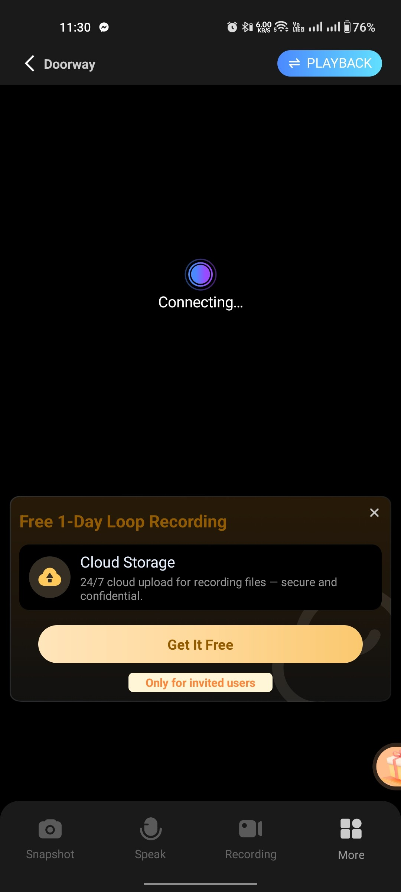
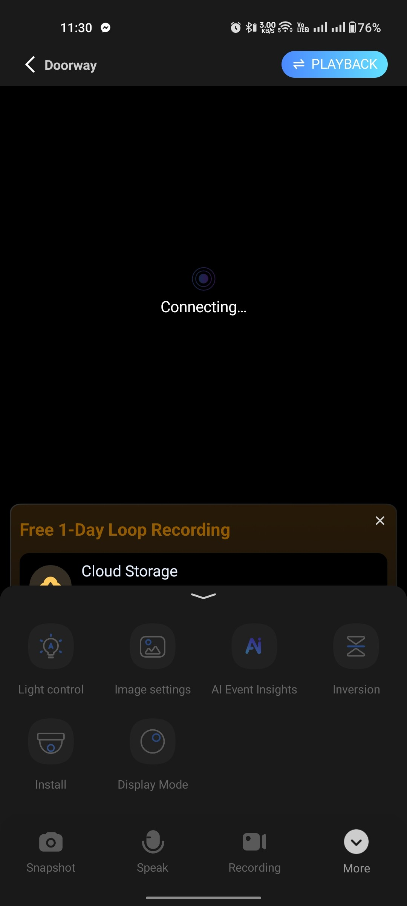
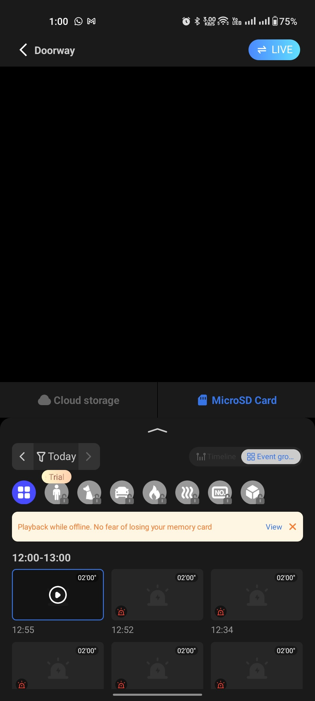
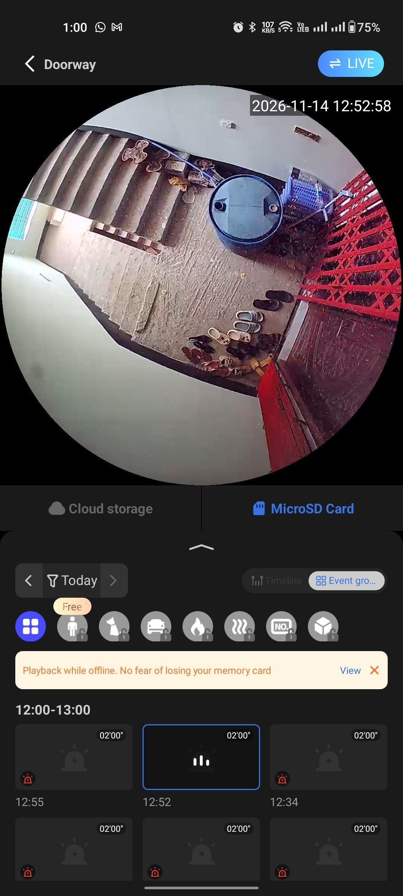
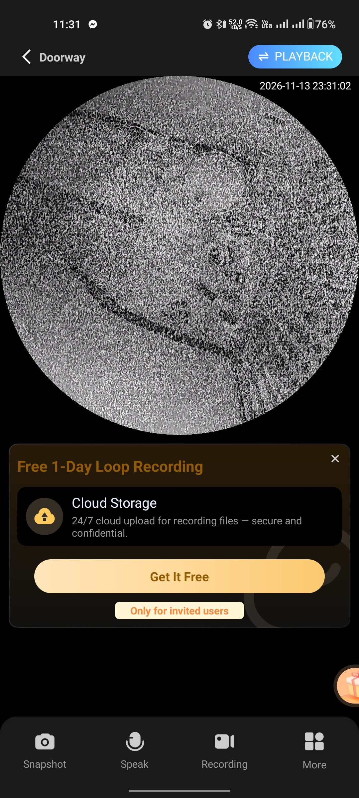
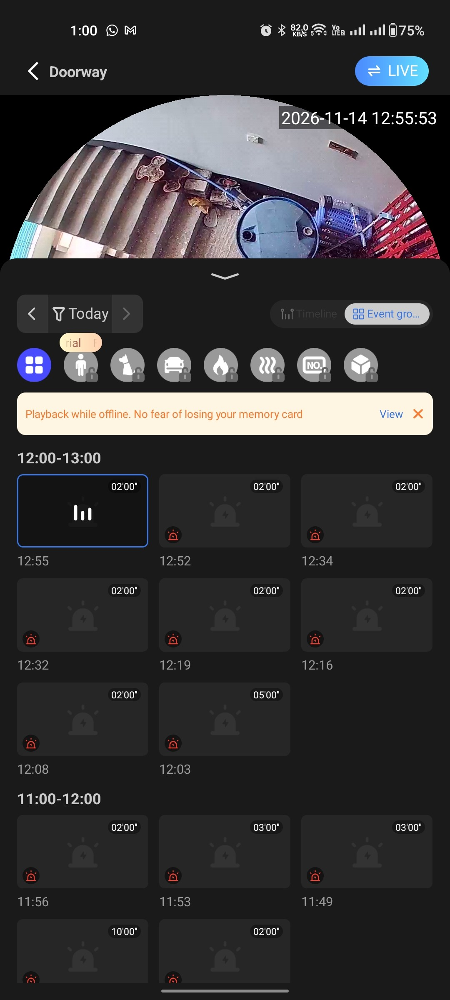

# V380 Camera Client (Standalone Android App & Local Bridge)

A 100% local, privacy-respecting client for V380-compatible smart IP cameras. Replaces vendor mobile apps with a clean, cloud-free experience: no external accounts, no cloud subscriptions, no telemetry, and zero outbound internet traffic required.

---

## Highlights

- **Zero Cloud / 100% Local**: Communicates directly with your cameras over the local network via TCP port 8800.
- **Standalone Android App**: Runs independently on phone or tablet with **no computer required**. Built with modern .NET for Android (C#) using native `MediaCodec` hardware video decoding and Android Keystore AES-GCM credential encryption.
- **Local Desktop Bridge**: Lightweight Python/C# loopback service for PC browsers (`http://127.0.0.1:8080`) and home server deployments.
- **Full Camera Control**:
  - Low-latency live video streaming (~4–5 fps snapshot polling or continuous decoding).
  - Live audio listening (G.711 A-law decoded to 16-bit PCM WAV).
  - MicroSD card event playback with scrubbable timeline.
  - MP4 video clip export directly to your device storage via `MediaMuxer`.
  - Motion alarm configuration with interactive 6x8 cell detection grid read/write.
  - Physical night light and infrared toggle controls.
- **Mobile-First Responsive UI**: Fast, responsive web UI embedded directly in the Android app and installable as a Progressive Web App (PWA) on desktop.
- **Honest Capability Tracking**: Data-driven capability profiles. Untested features on specific camera firmwares remain explicitly labeled **"Not confirmed"** rather than assuming support.

---

## Screenshots

| Original App (Aggressive Cloud Upsell) | Original App Controls Menu |
| :---: | :---: |
|  |  |

| MicroSD Event Playback List | Timeline & Event Playback |
| :---: | :---: |
|  |  |

| Night Vision Doorway Preview | Daytime MicroSD Playback |
| :---: | :---: |
|  |  |

---

## Architecture

The project is structured into two interoperable clients sharing the exact same frontend assets:

```
v380-camera-client/
├── android/V380Cameras/    # Standalone .NET for Android application
│   ├── App/                # Camera session, manager, keystore encryption, storage
│   ├── Core/               # Pure C# V380 TCP protocol implementation (port 8800)
│   ├── Http/               # In-process loopback HTTP servers (one per camera)
│   ├── Media/              # MediaCodec video decoder, Alaw audio, MediaMuxer MP4 exporter
│   ├── MainActivity.cs     # Android Activity hosting WebView & native JS bridge
│   └── V380Cameras.csproj  # Target net10.0-android, API 24-36, ARM64 & ARM32
├── ui/                     # Responsive HTML5/JS/CSS frontend (packaged into APK & desktop)
├── camera-manager.py       # Desktop loopback multi-camera manager (port 8080)
├── camera-web.py           # Desktop per-camera HTTP bridge
├── cameras.example.json    # Example configuration template
└── images/                 # App and protocol reference screenshots
```

### Standalone Android App Internals
1. **In-Process Protocol Client (`Core/`)**: Connects directly to the camera's TCP port 8800, handling the proprietary binary handshake, ticket authentication, and stream demuxing.
2. **Buffer-to-Buffer Video Pipeline (`Media/VideoDecoder.cs`)**: Decodes H.264 video using Android's native `MediaCodec` in buffer-to-buffer mode (`COLOR_FormatYUV420Flexible`). YUV frames are converted to NV21 and compressed via `YuvImage.CompressToJpeg`, avoiding buggy surface drivers on customized OEM Android ROMs.
3. **Hardware Keystore Protection (`App/SecretProtector.cs`)**: Passwords are encrypted with AES-256-GCM using a master key securely stored in the **Android Keystore** (`v380-camera-secrets`). Sensitive credentials are kept in app-private storage and never exposed to external storage or logs.
4. **Isolated Ephemeral Loopback Bridge (`Http/`)**: The app spins up in-process HTTP servers on loopback (`127.0.0.1`) for the manager and each camera, allowing the shared `ui/` frontend to function identically inside the Android `WebView` without modifications.
5. **Native Storage Integration (`MainActivity.cs`)**: Snapshots are saved to the device's gallery via `AndroidCameras.savePhoto()` JavaScript bridge, and downloaded MP4 clips are streamed into the public `Movies` / `Download` directories via the `MediaStore` API.

---

## Getting Started: Standalone Android App

### Prerequisites
- .NET 10 SDK with Android workload (`dotnet workload install android`)
- JDK 17 (set `JAVA_HOME`)
- Android SDK (API 24 or newer; build-tools 36.0.0+ recommended)

### Build & Install

You can build and deploy using the included PowerShell script:

```powershell
# Build signed Release APK
.\android\V380Cameras\build.ps1

# Build and automatically install to a USB-connected phone with ADB enabled:
.\android\V380Cameras\build.ps1 -Install
```

Or build manually via the .NET CLI:
```bash
dotnet build android/V380Cameras/V380Cameras.csproj -c Release
```
The output APK will be located at:
`android/V380Cameras/bin/Release/net10.0-android/local.v380.cameras-Signed.apk`

### First Launch on Phone
1. When launched, the app contains **no pre-seeded credentials**.
2. Tap **Add camera**.
3. Enter:
   - **Name**: e.g., "Front Door"
   - **IP Address**: Camera's local IP (e.g., `192.168.1.100`)
   - **Device ID**: Numeric ID printed on the camera label or sticker
   - **Username**: Camera user (typically `admin` or custom account)
   - **Password**: Your camera password
   - **Stream**: SD or HD
4. Tap **Save**. The camera card appears on your dashboard and immediately connects over your local Wi-Fi.

---

## Getting Started: Desktop Bridge

If you prefer running a local server on your PC or home server (e.g. Raspberry Pi / mini PC):

### Prerequisites
- Python 3.8+
- FFmpeg installed and available on `PATH`
- .NET runtime (for protocol decoder)

### Setup
1. Copy the example configuration:
   ```bash
   cp cameras.example.json cameras.local.json
   ```
2. Edit `cameras.local.json` with your camera IP, Device ID, and credentials.
3. Start the camera manager:
   ```bash
   python camera-manager.py
   ```
4. Open your browser and navigate to:
   ```
   http://127.0.0.1:8080
   ```
5. You can install the page as a Progressive Web App (PWA) via Chrome/Edge ("Install app" icon in the address bar).

---

## Protocol & Reverse-Engineering Insights

The V380 communication protocol uses proprietary binary framing over TCP port 8800:
- **Authentication**: A multi-step handshake exchanging a device ID, challenge nonces, and MD5-hashed credentials yielding a session ticket.
- **Framing**: Packets begin with a 4-byte magic header followed by opcode, sequence numbers, and payload length.
- **Video Stream**: Carried as raw H.264 Annex-B NAL units. Keyframes include SPS/PPS parameter sets.
- **Audio Stream**: G.711 A-law sampled at 8 kHz.
- **SD Card File Listing & Playback**: Event recordings are stored in a FAT filesystem on the camera's MicroSD card. Playback requests return variable-frame-rate video and IMA-ADPCM audio.
- **Alarm Registers**: Opcodes 321 (Read) and 322 (Write) read and write motion alarm configuration, including schedule windows and a 6×8 cell detection bitmap (48 bits).

---

## Security & Privacy Notice

- **Never publish credentials**: `cameras.local.json` and any local configuration files contain sensitive plaintext passwords and must never be committed to public repositories. `.gitignore` is pre-configured to exclude these files.
- **Local Network Scope**: The web servers in both the desktop version and the Android app bind strictly to `127.0.0.1` (loopback). They do not expose open ports to the broader LAN or WAN.

---

## License

This project is distributed under the [MIT License](LICENSE).

### Disclaimer
This is an independent open-source reverse-engineering project created for interoperability, local ownership, and privacy. It is **not** affiliated with, endorsed by, or associated with MacroVideo, V380, or any of their affiliates. All trademarks, service marks, and trade names are the property of their respective owners.
